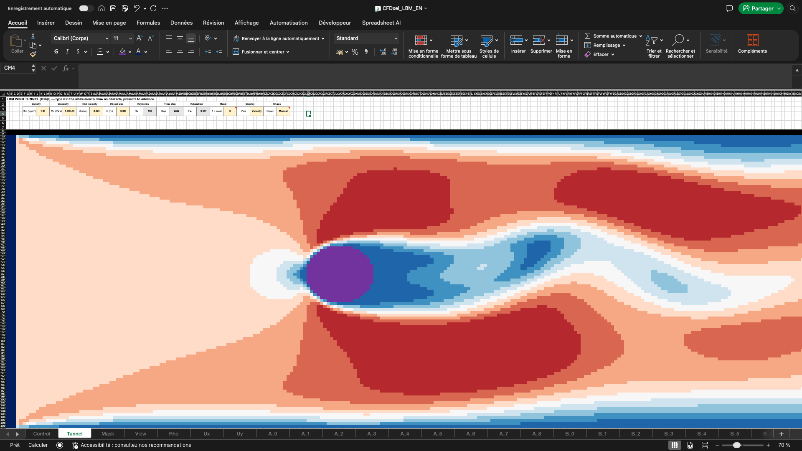
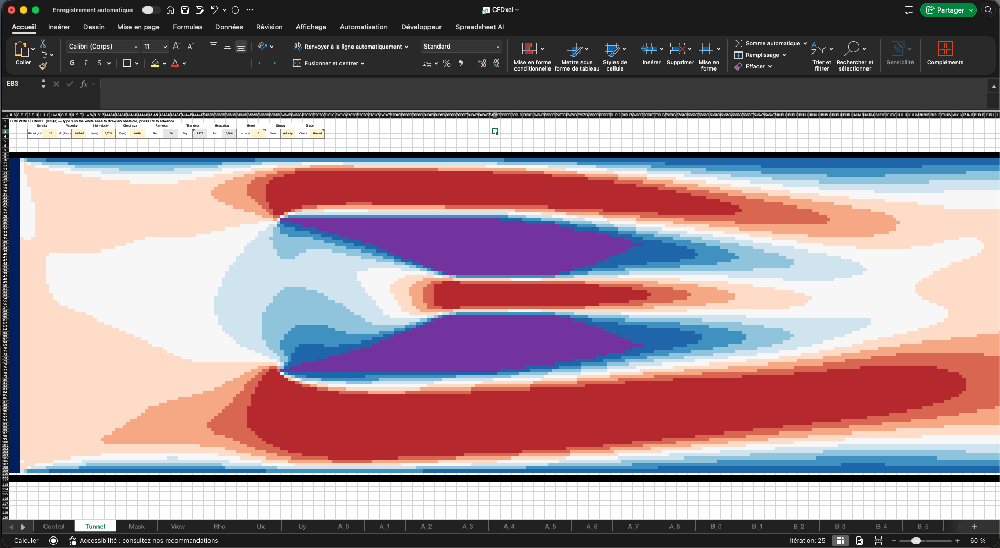
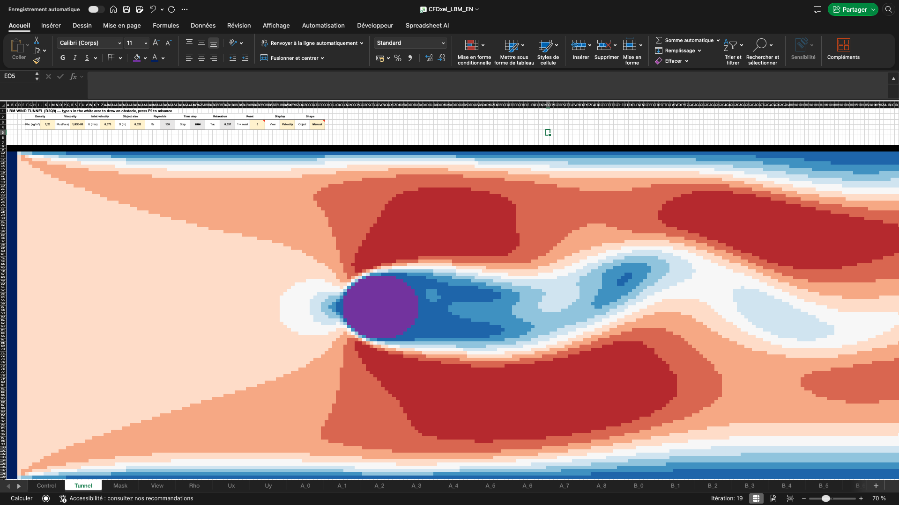
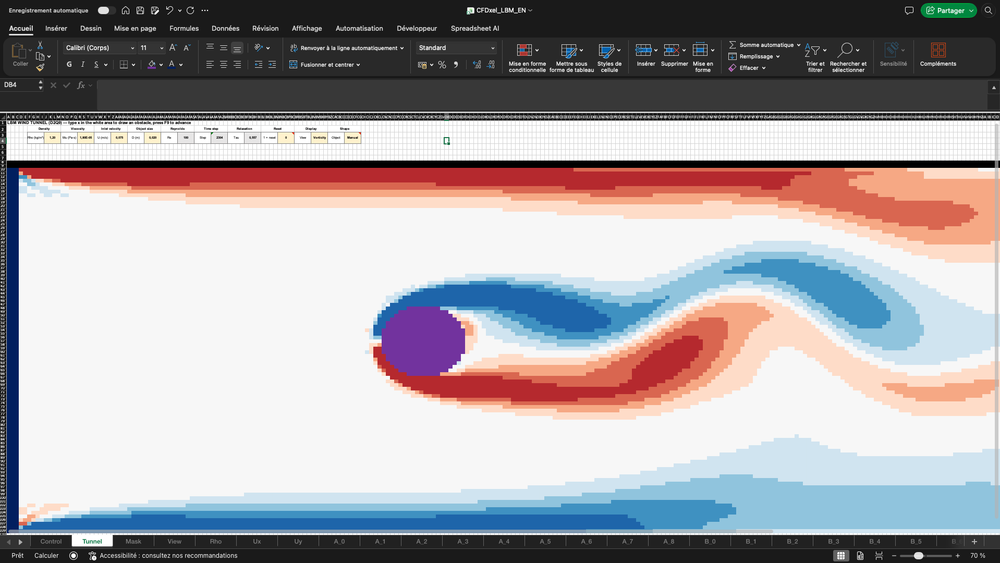
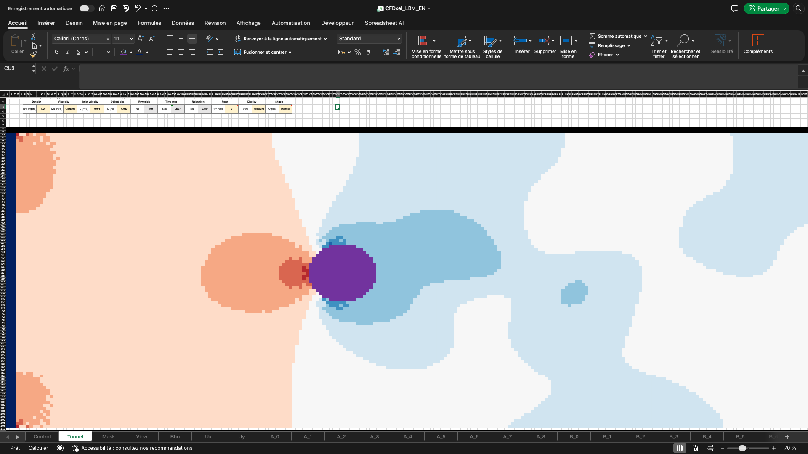
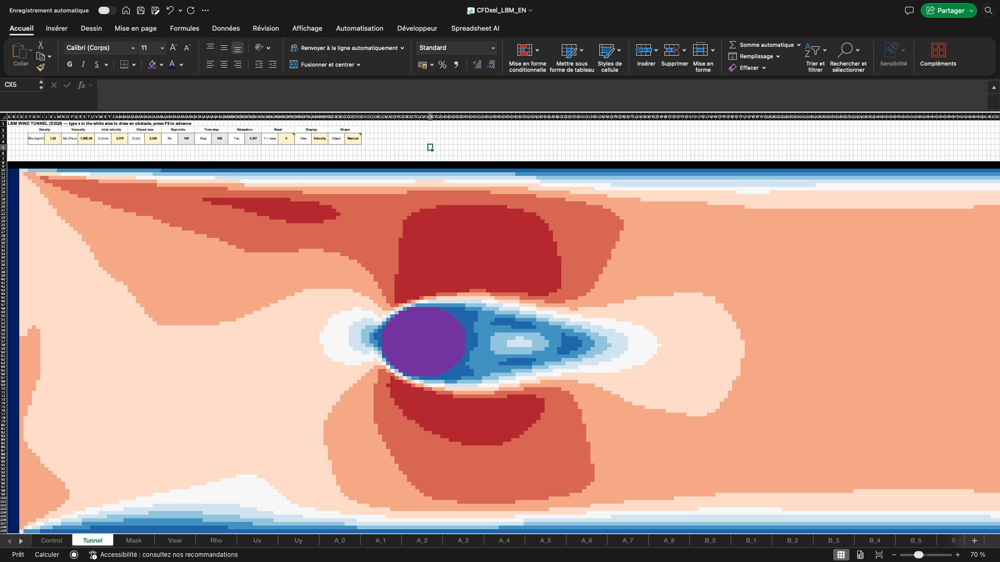
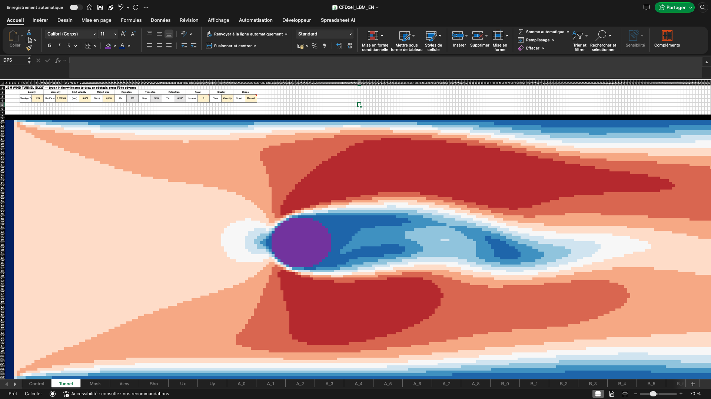
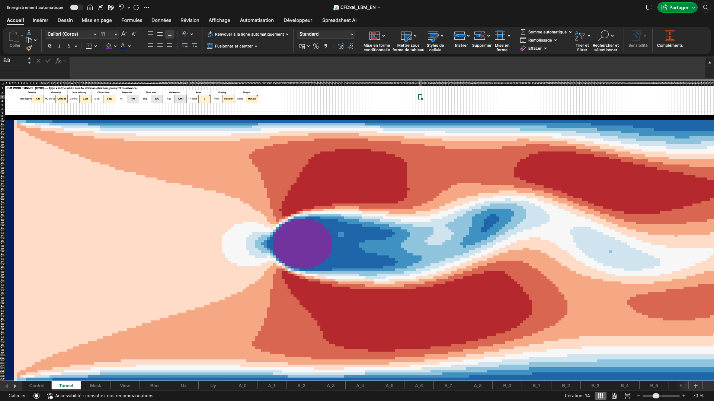

# How CFDxel Works

This document explains the numerical method, how it maps onto spreadsheet cells, and the trick that makes Excel advance a simulation in time using only formulas.

---

## 1. Why Lattice Boltzmann?

Classic CFD solves the Navier–Stokes equations for velocity and pressure. That requires solving a global pressure equation at every step, which is very awkward to express as independent cell formulas.

The **Lattice Boltzmann Method (LBM)** works differently. It tracks *distributions of fictitious particles* moving on a grid, and gets the fluid behaviour from their collective statistics. It has three properties that make it a natural fit for a spreadsheet:

- **Locality.** Each cell only needs values from itself and its 8 neighbours at the previous step.
- **Explicit time stepping.** There are no linear systems to solve, so one formula evaluation gives one cell update.
- **Trivial walls.** Solid cells are handled with a single `IF` (bounce-back).

In the low-Mach limit, LBM recovers the incompressible Navier–Stokes equations.

## 2. The D2Q9 model

Each fluid cell stores **9 populations** $f_i$. Population $f_i$ is the amount of fluid moving with discrete velocity $\mathbf{c}_i$:

| i | 0 | 1 | 2 | 3 | 4 | 5 | 6 | 7 | 8 |
|---|---|---|---|---|---|---|---|---|---|
| direction | rest | E | N | W | S | NE | NW | SW | SE |
| $c_x$ | 0 | 1 | 0 | −1 | 0 | 1 | −1 | −1 | 1 |
| $c_y$ | 0 | 0 | 1 | 0 | −1 | 1 | 1 | −1 | −1 |
| weight $w_i$ | 4/9 | 1/9 | 1/9 | 1/9 | 1/9 | 1/36 | 1/36 | 1/36 | 1/36 |
| opposite | 0 | 3 | 4 | 1 | 2 | 7 | 8 | 5 | 6 |

Here $c_y = +1$ means "up", which is towards *smaller* row numbers in Excel.

**Macroscopic quantities** are moments of the populations:

$$\rho = \sum_i f_i \qquad \rho\,\mathbf{u} = \sum_i f_i\,\mathbf{c}_i$$

**Equilibrium distribution:**

$$f_i^{eq} = w_i\,\rho\left(1 + 3\,\mathbf{c}_i\cdot\mathbf{u} + \tfrac{9}{2}(\mathbf{c}_i\cdot\mathbf{u})^2 - \tfrac{3}{2}|\mathbf{u}|^2\right)$$

**One time step** has two parts:

1. **Streaming.** Each population moves one cell along its direction.
2. **Collision (BGK).** Each population relaxes towards equilibrium:

$$f_i^{new} = f_i - \frac{f_i - f_i^{eq}}{\tau}$$

The relaxation time $\tau$ sets the viscosity: $\nu = (\tau - \tfrac12)/3$ in lattice units.

## 3. Mapping the method onto Excel

### 3.1 One sheet per population

Every grid-based sheet uses the same layout as the `Tunnel` sheet: the same rows and columns. A cell address such as `D10` therefore means the same physical location on every sheet, and relative references copy cleanly.

- `A_0` … `A_8` hold the 9 populations (buffer **A**).
- `B_0` … `B_8` hold a second copy (buffer **B**).
- `Mask` holds 1 for solid cells and 0 for fluid cells.

### 3.2 Pull streaming + collision in a single formula

The solver uses the **pull** formulation. To update cell $\mathbf{x}$, each population is read from the upstream neighbour $\mathbf{x}-\mathbf{c}_i$, and the collision is applied right away. The stored state is the **post-collision** distribution.

For direction 1 (East) in cell `D10` of buffer A, which reads from buffer B:

```excel
=IF(Reset, IF(Mask!D10=1, W_1, In_1),
 IF(Phase=1, A_1!D10,                                   ← hold (B's turn)
 IF(Mask!D10=1, W_1,                                    ← solid cell
 LET(
   g0, B_0!D10,
   g1, IF(Mask!C10=1, B_3!D10, B_1!C10),                ← pull from the West, or bounce back
   g2, IF(Mask!D11=1, B_4!D10, B_2!D11),
   g3, IF(Mask!E10=1, B_1!D10, B_3!E10),
   g4, IF(Mask!D9 =1, B_2!D10, B_4!D9),
   g5, IF(Mask!C11=1, B_7!D10, B_5!C11),
   g6, IF(Mask!E11=1, B_8!D10, B_6!E11),
   g7, IF(Mask!E9 =1, B_5!D10, B_7!E9),
   g8, IF(Mask!C9 =1, B_6!D10, B_8!C9),
   rho, g0+g1+g2+g3+g4+g5+g6+g7+g8,
   ux, (g1+g5+g8-g3-g6-g7)/rho,
   uy, (g2+g5+g6-g4-g7-g8)/rho,
   cu, ux,                                              ← c_1 · u
   g1 - (g1 - W_1*rho*(1+3*cu+4.5*cu^2-1.5*(ux^2+uy^2)))/Tau ))))
```

All 18 buffer sheets use this same template. Only three things change from one direction to the next: the `cu` line ($\mathbf{c}_i\cdot\mathbf{u}$), the weight `W_i` and the returned `g_i`.

### 3.3 Bounce-back walls

If the upstream neighbour of direction $i$ is solid, nothing can arrive from it. Instead, the cell takes the population that left in the **opposite** direction at the previous step. That is the `IF(Mask!…=1, B_opp!self, B_i!neighbour)` in every `g` line. It implements a no-slip wall located halfway between the fluid cell and the solid cell.

Solid cells themselves hold the rest-state equilibrium $w_i$. That way, if you erase part of an obstacle, the freed cells restart from still fluid instead of from zero density, which would cause a division by zero.

### 3.4 Inlet and outlet

- **Inlet** (first three columns, blue): populations are fixed to $f_i^{eq}(\rho=1, \mathbf{u}=(U,0))$.
  - During the first *Kick duration* steps, a small vertical velocity is added.
  - This breaks the flow's symmetry so that vortex shedding starts sooner.
- **Outlet** (last column): zero-gradient. Each population copies the column to its left.
- **Top and bottom walls** (black rows): bounce-back, through the mask.

The boundaries are all visible on the canvas. In the screenshot below, the dark blue strip on the far left is the inlet, the black row at the top is a wall, and the slow (blue) layers hugging the top and bottom are the no-slip boundary layers produced by bounce-back.



## 4. Turning Excel into a time integrator

### 4.1 Iterative calculation

Excel normally refuses circular references. With **iterative calculation** enabled, it accepts them: on each recalculation (F9), it re-evaluates circular cells up to *Maximum iterations* times. CFDxel uses **each iteration as one time step**.

### 4.2 The problem: Gauss–Seidel ordering

Within one iteration, Excel evaluates cells one after another. A cell computed late in the pass may read neighbours that were *already updated in the same pass*, while a cell computed early reads old values. A naive single-buffer scheme would mix time levels and give wrong results.

### 4.3 The solution: double buffering with a phase flag

The `Control` sheet holds a clock:

```excel
Phase:  =IF(Reset, 0, 1-Phase)     ← flips 0/1 every iteration
Tick:   =IF(Reset, 0, Tick+1)      ← step counter
```

- When **Phase = 0**, buffer **A** is computed from **B**, and **B holds** its value (`=B_i!self`).
- When **Phase = 1**, buffer **B** is computed from **A**, and **A holds**.

During any single iteration, the buffer being read is frozen. The order in which Excel visits the cells therefore no longer matters. The one remaining requirement is that `Phase` is evaluated before the other cells, which is why `Control` is the first sheet.

The display sheets (`Rho`, `Ux`, `Uy`) read whichever buffer was written last:

```excel
=IF(Mask!D10=1, 1, IF(Phase=1, B_0!D10+…+B_8!D10, A_0!D10+…+A_8!D10))
```

**How to check it works:**
- *Tick* must increase by exactly *Maximum iterations* on each F9.
- *Mean density* must change smoothly. A slow drift of a few percent is normal with the open inlet and outlet; a sudden jump is not.

## 5. Units, Reynolds number and stability

The user enters physical values: $\rho$, $\mu$, $U$ and $D$. From these:

$$Re = \frac{\rho\,U\,D}{\mu}$$

The lattice side uses a fixed lattice velocity $U_{lu}$ (default 0.1) and the object height $D_{lu}$ in cells. $D_{lu}$ is measured automatically from the mask: it is the number of rows that contain solid object cells.

$$\nu_{lu} = \frac{U_{lu}\,D_{lu}}{Re} \qquad \tau = \max\left(\tau_{min},\; 3\,\nu_{lu} + \tfrac12\right)$$

**Stability.** Plain BGK becomes unstable as $\tau \to 0.5$, so $\tau$ is clamped at $\tau_{min} = 0.52$. That clamp caps the Reynolds number the grid can simulate:

$$Re_{sim} = \frac{U_{lu}\,D_{lu}}{(\tau - 0.5)/3}$$

The *Control* sheet shows $Re_{sim}$ next to the physical Re. If they differ, the grid is too coarse for the requested flow.

**Back to physical units:**

$$\Delta x = \frac{D}{D_{lu}} \qquad \Delta t = \frac{U_{lu}\,\Delta x}{U} \qquad p - p_0 = \frac{\rho_{lu}-1}{3}\,\rho\left(\frac{\Delta x}{\Delta t}\right)^2$$

**Compressibility.** LBM is weakly compressible, with lattice sound speed $c_s = 1/\sqrt3$. $U_{lu} = 0.1$ gives a lattice Mach number of about 0.17, low enough for incompressible behaviour.

## 6. Geometry: the mask

`Mask` is computed from three sources, combined with a logical OR:

1. **Walls.** The rows above and below the fluid domain are always solid.
2. **Hand-drawn cells.** Any non-empty cell on the `Tunnel` canvas: `Tunnel!D10<>""`.
3. **A predefined shape**, chosen with `CHOOSE(MATCH(Shape, ShapeList, 0), …)`:
   - **Circle:** $(x-x_c)^2 + (y-y_c)^2 \le (L/2)^2$
   - **Rectangle:** $|x-x_c| \le L/2$ and $|y-y_c| \le H/2$
   - **NACA 0012:**
     - First, rotate the coordinates by the angle of attack $\alpha$ into the chord frame $(X, Y)$, normalised by the chord $L$.
     - A cell is solid when $0 \le X \le 1$ and
     $$|Y| \le 0.6\left(0.2969\sqrt{X} - 0.126X - 0.3516X^2 + 0.2843X^3 - 0.1015X^4\right)$$

Because the mask is recalculated on every F9, you can edit the obstacle while the flow is running.

Hand-drawn cells can form any shape. Here, two wedges were typed in with `x`. Their edges are staircased onto the grid, as with any bounce-back geometry, but the flow still behaves as expected: a fast jet through the gap and a slow wake behind each body.



## 7. Visualisation

Excel's color-scale conditional formatting can only color a cell from *its own* value. The canvas cells, though, hold `x` or nothing. CFDxel therefore uses **formula-based conditional formatting rules that reference another sheet**:

1. `=D10<>""` → purple. This shows drawn cells immediately, even before F9.
2. `=Mask!D10=1` → purple. This shows predefined shapes.
3. Nine banded rules, from `=View!D10>=0.889` down to `TRUE`, map the value to a 9-color diverging palette.

`View` holds a value normalised to [0, 1] for the selected mode:

- **Velocity:** $|\mathbf{u}| / (1.5\,U_{lu})$
- **Vorticity:** $0.5 + \omega / (2\,\omega_{scale})$, with $\omega = \partial_x u_y - \partial_y u_x$ computed by central differences
- **Pressure:** $0.5 + (\rho - \bar\rho)/(2\,\Delta\rho_{scale})$

In all three modes, 0.5 sits in the white middle band of the palette, low values are blue and high values are red. Solid cells always show in purple, whatever the mode.

| Velocity | Vorticity | Pressure |
|---|---|---|
|  |  |  |
| $\lvert\mathbf{u}\rvert$ is never negative, so the palette runs from blue (still fluid in the wake and along the walls) to red (fast flow around the sides of the cylinder). | The shear layers leaving the top and bottom of the cylinder carry opposite signs of $\omega$: blue (clockwise) on top, red (counter-clockwise) below. They roll up into alternating vortices. | The stagnation point in front of the cylinder is red (high $\rho$, so high pressure). The wake and the cores of the shed vortices are blue (low pressure). |

## 8. Validation

- **Formula correctness.** A NumPy implementation of exactly the same scheme was run for several hundred steps. Its state was injected into buffer B, and the workbook computed buffer A from it. Every population matched the NumPy step to about $10^{-15}$. The check was run in LibreOffice on a reduced grid, using `LET`-free versions of the formulas.
- **Physics.** On the full 100 × 300 grid with a 20-cell cylinder at Re = 100, the NumPy reference stays stable and produces periodic vortex shedding with a period of about 1,000 steps.
- **In Excel.** The workbook reproduces the expected sequence for a cylinder at this Reynolds number. The wake starts as a symmetric pair of recirculation zones, grows longer, becomes unstable and then sheds vortices alternately from each side:

| Symmetric wake | Onset of oscillation | Periodic shedding |
|---|---|---|
|  |  |  |

## 9. Possible extensions

- **Better boundaries:** Zou–He velocity inlet and pressure outlet, to remove the slow density drift.
- **Better collision:** MRT or TRT collision operators, for higher Reynolds numbers at the same resolution.
- **Forces on the obstacle:** drag and lift coefficients ($C_d$, $C_l$) via momentum exchange, as a single `SUMPRODUCT` over boundary cells.
- **Passive scalar:** a dye or temperature field advected by the flow, using a second, simpler lattice.

