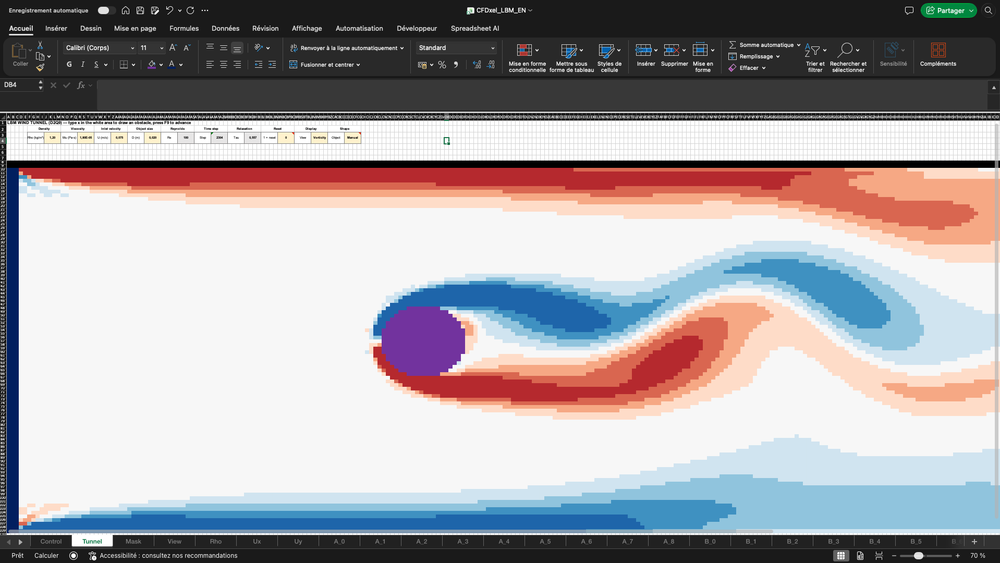
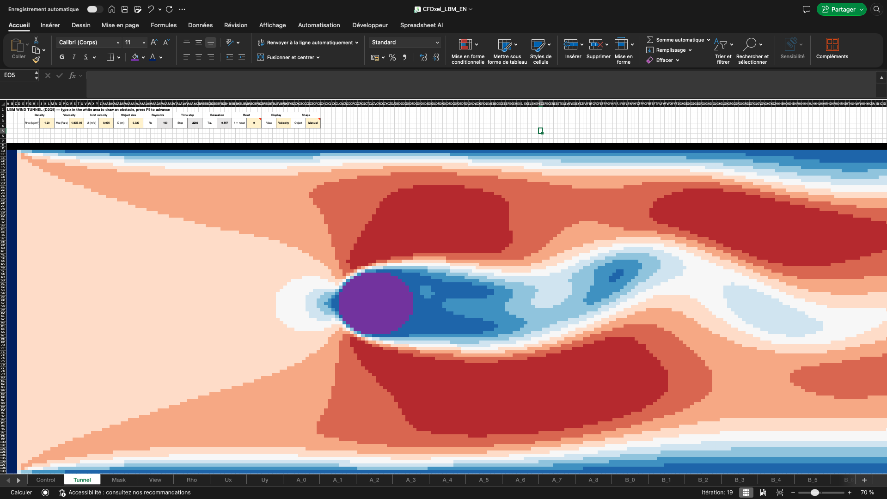
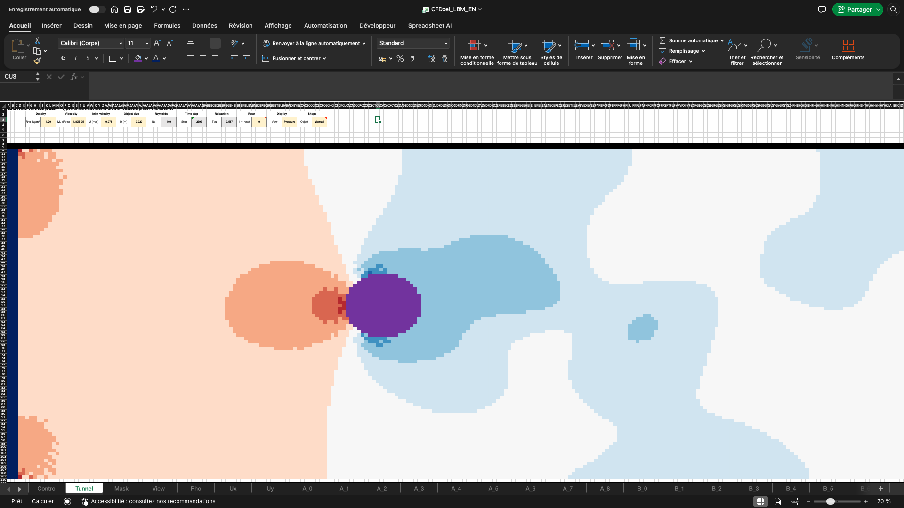
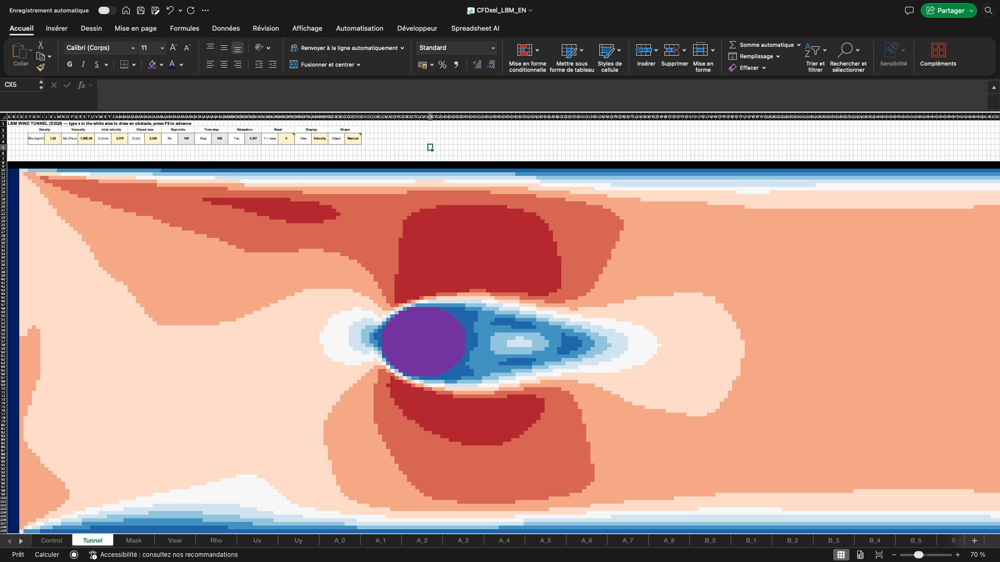
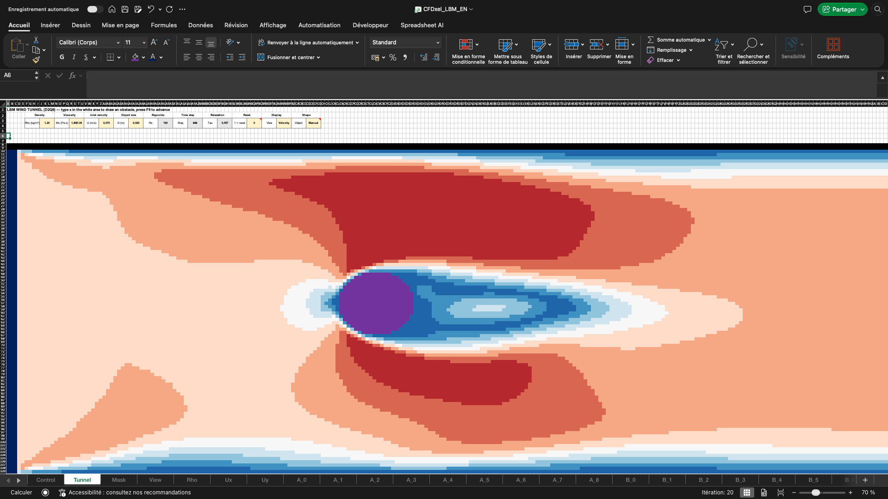
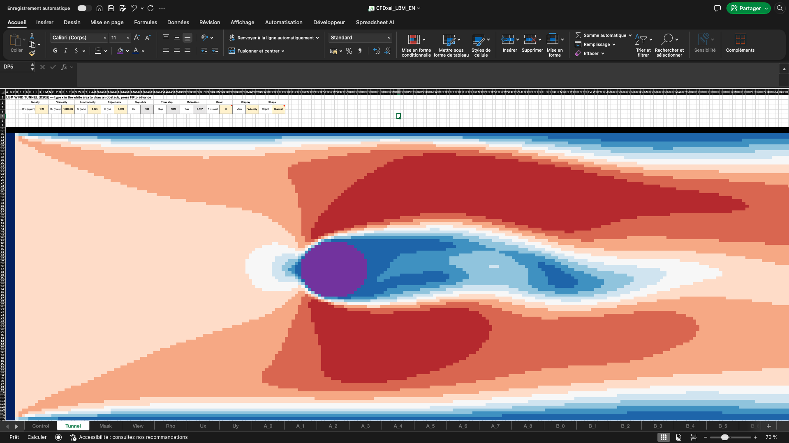
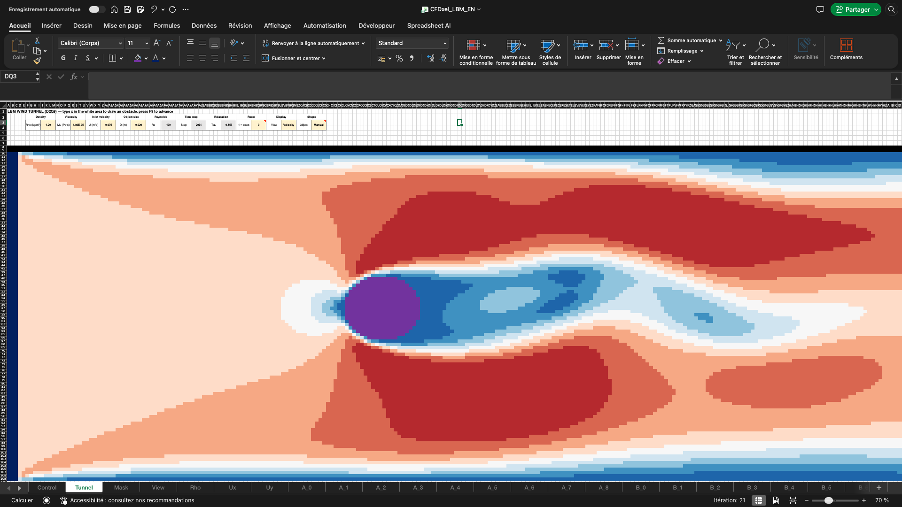
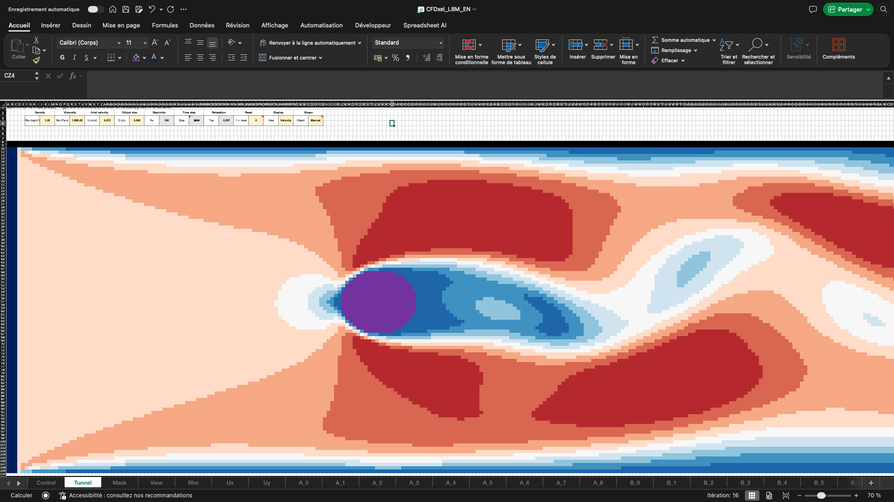
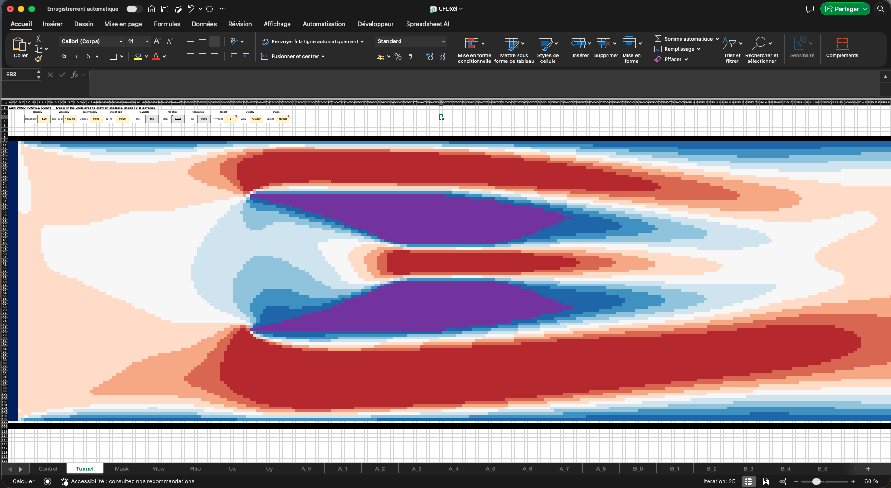

# CFDxel — A Wind Tunnel in Pure Excel Formulas

**CFDxel** is a 2D computational fluid dynamics (CFD) wind tunnel that runs entirely inside a Microsoft Excel workbook — **no VBA, no macros, no add-ins, only cell formulas**.

You draw an obstacle by typing `x` into cells, press **F9**, and watch the flow develop around it, including the classic **von Kármán vortex street** shed behind a cylinder.

Under the hood it is a **Lattice Boltzmann (D2Q9, BGK)** solver. Each time step is one pass of Excel's iterative calculation engine.

*A von Kármán vortex street behind a 20-cell cylinder at Re = 100, after about 2,300 time steps. Every colored square is an Excel cell. Blue and red are vortices spinning in opposite directions; the purple disc is the obstacle.*

---

## Features

- **Formulas only.** Every cell of every population is a plain Excel formula. You can click on any cell and read the physics.
- **Draw your own obstacle.** Type `x` in the tunnel to add solid cells, press Delete to remove them. Changes take effect on the next F9, without restarting the simulation.
- **Predefined shapes:** circle, rectangle and **NACA 0012 airfoil**, with adjustable position, size and angle of attack. They can be combined with hand-drawn cells.
- **Three live views**, rendered with conditional formatting directly on the drawing canvas:
  - **Velocity** magnitude
  - **Vorticity**, which shows the vortex street best
  - **Pressure**, as the density deviation
- **Physical inputs:** density, dynamic viscosity, inlet velocity and object size give a Reynolds number. The workbook converts it into lattice parameters and back into physical units (dx, dt, simulated time).
- **Built-in sanity checks:** a step counter and a mean-density monitor.

## The three views

The same flow seen through each display mode, with the three screenshots taken within about 100 steps of each other. Switch between them with the **View** cell; no recalculation of the flow is needed.

| Velocity | Vorticity | Pressure |
|---|---|---|
|  |  |  |
| Speed of the flow. Red is fast, blue is slow. The blue wake behind the cylinder and the slow layers along the top and bottom walls are clearly visible. | Local spin of the fluid. Red and blue are opposite directions of rotation, white is no rotation. Best view for the vortex street. | Pressure relative to the mean. Red is high pressure (the stagnation point in front of the cylinder), blue is low pressure (the wake). |

## Grid

| Item | Value |
|---|---|
| Fluid domain | 100 rows × 300 columns |
| Default obstacle | cylinder, 20 cells in diameter |
| Default Reynolds number | 100 |
| Maximum reachable Reynolds number | about 300 (limited by grid resolution) |
| Formulas | about 540,000 |
| File size | about 50 MB |

## Quick start

1. Open `CFDxel_LBM_EN.xlsx`. It may take a few seconds because of the large number of formulas.
2. Go to **File → Options → Formulas** and check two settings:
   - **Enable iterative calculation** is on. Maximum iterations = 20 is the number of time steps per F9.
   - **Workbook calculation** is set to **Manual**.

   The file stores these settings, but Excel applies the settings of the first workbook opened in a session.
3. On the **Tunnel** sheet, set **Reset = 1** and press **F9**. This initialises the flow.
4. Set **Reset = 0**.
5. Press **F9** repeatedly, or hold it down. Each press advances the simulation by 20 steps.
6. Switch **View** to *Vorticity*. The vortex street appears after about 3,000 steps, which is about 150 presses.

### What to expect

With the default cylinder, the wake goes through four recognisable stages. These screenshots use the *Velocity* view:

| 1. Symmetric wake | 2. Wake grows longer |
|---|---|
|  |  |
| A short, symmetric pair of slow (blue) recirculation zones forms behind the cylinder. | The wake stretches downstream but stays symmetric. |
| **3. Wake starts to oscillate** | **4. Vortex shedding** |
|  |  |
| The tail of the wake begins to swing up and down. | Blobs of slow fluid detach alternately from the top and bottom and travel downstream: the vortex street. |

Once shedding has started it continues periodically, as long as you keep pressing F9:

## Draw your own obstacle

Any cell in the white area that contains a value becomes solid on the next F9. The example below uses two hand-drawn wedges instead of the cylinder. The fluid squeezed between them accelerates into a fast jet (dark red in the middle), while a slow wake trails behind each wedge.

## Controls

All main controls are at the top of the **Tunnel** sheet. Advanced settings are on the **Control** sheet.

| Control | Where | Meaning |
|---|---|---|
| Density, Viscosity | Tunnel | Fluid properties (Rho in kg/m³, Mu in Pa·s) |
| Inlet velocity, Object size | Tunnel | U in m/s and D in m, used for the Reynolds number |
| Reset | Tunnel | 1 = initialise, 0 = run |
| View | Tunnel | Velocity / Vorticity / Pressure |
| Shape | Tunnel | Manual / Circle / Rectangle / NACA 0012 |
| Shape centre, size, angle | Control | Parameters of the predefined shape |
| U_lu | Control | Lattice velocity (default 0.1). Larger values run faster but are less accurate; keep it ≤ 0.15 |
| Minimum Tau | Control | Stability floor (default 0.52) |
| Kick duration / amplitude | Control | A short sideways gust at the inlet that triggers vortex shedding |

## Workbook layout

| Sheet | Role |
|---|---|
| `Control` | Parameters, clock (Phase/Tick), unit conversion, D2Q9 constants |
| `Tunnel` | Drawing canvas and live display |
| `Mask` | 1 = solid, 0 = fluid (walls + typed `x` + predefined shape) |
| `View` | Normalised value displayed on the canvas |
| `Rho`, `Ux`, `Uy` | Density and velocity fields |
| `A_0` … `A_8`, `B_0` … `B_8` | The 9 particle populations, double-buffered |

See **[HOW_IT_WORKS.md](HOW_IT_WORKS.md)** for the method, the formulas and the trick that turns Excel's circular-reference engine into a time integrator.

## Performance tips

- Each F9 recomputes about 540,000 formulas per time step, so expect several seconds per press. Closing other workbooks helps.
- To run more steps per F9, increase *Maximum iterations*.
- To speed things up at some cost in accuracy, raise `U_lu` to 0.12–0.15.
- If cells show errors (division by zero, `#NUM!`), the simulation diverged. Set Reset = 1, press F9, set Reset = 0. The usual causes are a Tau too close to 0.5 or a `U_lu` that is too large.

## Limitations

- **2D and weakly compressible.** It is valid for low Mach numbers only, with lattice Mach ≈ 0.17.
- **Isothermal.** Temperature is not modelled.
- **Limited Reynolds number.** The grid caps the simulated Reynolds number at a few hundred. The *Control* sheet shows the Reynolds number that is actually simulated next to the physical one.
- **Simple boundaries.** Walls and obstacles use simple bounce-back, so curved shapes are staircased onto the grid. The inlet is a fixed equilibrium and the outlet is zero-gradient. The mean density drifts slowly upward, by about 2 % over 6,000 steps; that is expected with these boundaries.
- **Calculation order.** The method relies on Excel evaluating the `Phase` cell before the rest of the cells in each iteration. If the *Tick* counter does not increase by exactly the iteration count per F9, or the mean density jumps suddenly, that assumption is broken on your Excel build.

